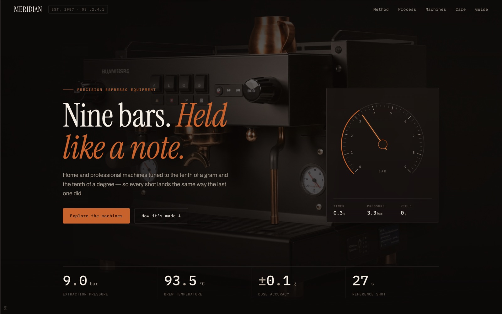

<!-- parable:beautified -->
<div align="center">

<h1>Meridian</h1>

<p><strong>Espresso equipment — live pressure-gauge hero + odometers.</strong></p>

<p>
  <a href="https://bswxyz.github.io/formwork-meridian/"></a>
  
  
  <a href="LICENSE"></a>
</p>

<p>
  <a href="https://bswxyz.github.io/formwork-meridian/"><b>Live demo</b></a>
  &nbsp;·&nbsp;
  <a href="https://bswxyz.github.io/formwork-meridian/guide/">Build notes</a>
  &nbsp;·&nbsp;
  <a href="https://parable-three.vercel.app/templates">More templates</a>
</p>

<a href="https://bswxyz.github.io/formwork-meridian/">
  
</a>

</div>

**Use this template** — copy the source into a new project:

```bash
npx degit bswxyz/formwork-meridian my-app
```


**Live demo → https://bswxyz.github.io/formwork-meridian/** · [How it was built](https://bswxyz.github.io/formwork-meridian/guide/)

> A precision-hardware landing page whose hero runs a live analog pressure gauge, and whose every
> number rolls into place like an odometer.

A free, MIT-licensed website template. Good for: **coffee equipment, precision hardware, appliance brands, spec-driven products**.
The demo brand ("MERIDIAN") is fictional — every word, price and colour is meant to be replaced with yours.

## The signature technique

- A live `<canvas>` pressure gauge running a continuous extraction cycle — needle sweep to nine bars, a mono shot-timer and yield counting up, then a drop and a loop
- Odometer stats: rolling digit columns that spin to their value on scroll, and re-spin when the brew method changes
- A scroll-linked "extraction line" that fills copper down the left edge, with a live percentage readout
- Machined-ruler section dividers, a real tablist segmented control, and a keyboard-operable numbered stepper

## Use this as your own site

This repo is a **template** — everything is plain HTML/CSS/JS with **relative paths**, so it
works under *any* repo name with zero configuration.

1. Click **Use this template → Create a new repository** (top of this page).
   **Name it whatever you like** — `my-site`, `roaster`, anything.
2. In your new repo: **Settings → Pages → Build and deployment → Deploy from a branch**,
   then pick `main` / `/ (root)` and save. (CLI: see below.)
3. Wait ~1 minute. Your site is live at `https://YOUR-USERNAME.github.io/YOUR-REPO-NAME/`.

<details>
<summary>Prefer the command line?</summary>

```bash
gh repo create my-site --template bswxyz/formwork-meridian --public --clone
cd my-site
gh api --method POST /repos/YOUR-USERNAME/my-site/pages \
  -f 'source[branch]=main' -f 'source[path]=/'
```
</details>

No build step, no dependencies to install — edit the files, push, done.
The only external requests are Google Fonts. Drop your product photography into `assets/`.

## Customize it

- The gauge: cycle timing (`RAMP`, `HOLD`, `DROP`, `REST`) and the max reading live at the top of the gauge block in `main.js`
- Methods & specs: the `M` object in `main.js` holds every dose / grind / temp / time / yield the segmented control rolls through
- Stats & prices: any element with a `data-odo` value and `data-roll` rolls in on view — change the number, change the readout
- Accent: one burnt copper in `:root` — swap for your brand

The `/guide/` page documents the signature technique in depth (with code) — keep it, rewrite it,
or delete the folder entirely.

## Files

```
index.html        the page
styles.css        all styling (design tokens in :root at the top)
main.js           the readout — gauge, odometer, segmented control, stepper
guide/index.html  how-it-works write-up (optional — yours to keep or delete)
```

## Built-in quality

- Works with JS disabled or a font-CDN failure (content is never permanently hidden)
- Respects `prefers-reduced-motion`; keyboard focus styles and a real tablist throughout
- Canvas feature-detected with a graceful fallback; devicePixelRatio capped for performance
- Responsive at phone / tablet / desktop widths

## Design system

| Token | Hex | Role |
| --- | --- | --- |
| `--bg` | `#0B0908` | warm near-black background |
| `--panel` | `#151110` | raised panels, cards |
| `--panel-2` | `#1B1512` | inset surfaces, gauge face |
| `--ink` | `#F4EDE4` | warm bone — primary text |
| `--dim` | `#A99E90` | secondary text |
| `--faint` | `#6E6458` | labels, ticks, hairline captions |
| `--accent` | `#C8622C` | burnt copper — the single loud accent |
| `--hot` | `#E98A4B` | hot copper highlight (needle, hovers) |
| `--oxide` | `#71351A` | oxide shadow at the base of the copper fill |
| `--line` | `rgba(244,237,228,.10)` | hairlines, machined rulers |

**Type pairing.** *Instrument Serif* carries the display voice (with italics for emphasis) because a
warm, high-contrast serif reads as ritual and craft, not tech. *Archivo* handles body copy — a grotesque
that stays neutral and legible at small sizes. *IBM Plex Mono* sets every eyebrow, spec row and readout,
so numbers line up in tabular columns and the whole thing reads like an instrument panel. Radius never
exceeds 4px: this brand is machined, not soft.

**Signature motion — "the readout".** Odometer-style digit reels roll every stat into place; a live canvas
pressure gauge runs a nine-bar extraction cycle with a counting shot-timer; a thin copper extraction line
fills down the page edge with scroll progress. Machined ruler tick marks divide the sections.

## Demo vs. real

Honest about the gap. **What's mocked here:**

- Every product, model number and price is fictional; the machines don't exist
- "Reserve →" anchors to the care section — there's no cart, checkout or inventory
- The care-plan CTA is a `mailto:` link, not a real signup or billing flow
- Imagery is AI-generated stills; a real brand shoots film for the hero and studio stills for the machines
- There is no backend, no database, no analytics — it's a single static page

**What a real build needs:**

- A commerce platform and payment processing for orders and reservations
- A CMS so specs, prices and recipes aren't hand-edited in HTML
- Real photography and a short hero film of an actual machine pulling a shot
- Order, warranty and serial-number systems, plus fulfilment and the field-service scheduling the
  care plans imply

## License & credit

[MIT](LICENSE) — free for personal and commercial use, no attribution required
(a link back is always appreciated). Part of **FORMWORK** — a collection of
free website templates: **[the full gallery →](https://bswxyz.github.io/formwork/)**
